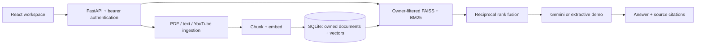

# AI Knowledge Assistant

A React workspace and FastAPI service for questions grounded in your PDF, text, Markdown, and YouTube transcripts. Hybrid FAISS/BM25 retrieval uses reciprocal rank fusion; Gemini generates answers with source citations. Server-controlled user identities isolate document storage, search, and deletion.

**Status:** runnable portfolio application. Local mode needs no model API key and returns excerpts. Gemini, semantic embeddings and live YouTube ingestion require configuration/network access. This is not a claim of a completed production deployment.

## Architecture



## Quick start

Requires Python 3.11 and Node 22.12+.

```bash
python -m venv .venv
# Windows: .venv\Scripts\Activate.ps1
# macOS/Linux: source .venv/bin/activate
pip install -r requirements.txt
```

Copy `.env.example` to `.env`. Replace `USER_TOKENS` with your own long random tokens mapped to stable user IDs. Keep that map on the server. Start the backend from the repository root:

```bash
uvicorn app.main:app --reload
```

In a second terminal:

```bash
cd frontend
npm ci
npm run dev
```

Open the Vite URL, enter an access token, upload a text document and ask about its contents. For a single server build, run `npm run build` inside `frontend`, then restart the backend; it serves the built interface at [localhost:8000](http://localhost:8000). API documentation is at `/docs`.

## Models and persistence

- Default `EMBEDDING_BACKEND=hash` uses deterministic lexical hash vectors for an offline demo. Set `sentence-transformers` for semantic embeddings; first use downloads the configured model.
- Default `GENERATION_BACKEND=extractive` shows matching excerpts. Set `gemini`, `GEMINI_API_KEY`, and a `GEMINI_MODEL` available in your account for generated answers.
- Embeddings and chunks persist in SQLite. A transient FAISS index and BM25 index are built **only from the authenticated user's chunks** at query time. This avoids unsafe pickle loading and cross-user global indexes. It targets modest portfolios, not millions of chunks.
- Model signatures are stored with chunks. Changing the embedding model requires deleting and re-ingesting documents. Mixed embeddings are rejected.
- When Gemini is enabled, the question and retrieved excerpts are sent to Google. Embeddings remain local with the default or sentence-transformers backend.

## API

All application routes require `Authorization: Bearer YOUR_TOKEN`.

| Method | Path | Purpose |
|---|---|---|
| POST | `/api/documents` | Multipart `file` upload |
| GET | `/api/documents` | List only your documents |
| DELETE | `/api/documents/{id}` | Delete your document and its chunks |
| POST | `/api/youtube` | JSON `{"video_id":"11-char-ID"}` |
| POST | `/api/ask` | JSON `{"question":"What is the policy?"}` |

Sources include document name, page/text/timestamp locator, chunk text, citation number and retrieval score. Citation validation checks that references exist; it cannot prove that every generated claim is supported. Review the original excerpts for consequential decisions. Document instructions never override the generation policy, but prompt injection remains a limitation of LLM applications.

## Boundaries

- 10 MB uploads, 100-page unencrypted PDFs, 200,000 extracted characters/document, 2,000 chunks/user.
- Scanned PDFs need OCR first. YouTube requires an available transcript and may be blocked by YouTube or your network.
- No registration or password system: an operator provisions and rotates tokens. Tokens stay in browser memory and are cleared on disconnect.
- Use HTTPS, a reverse proxy with body-size/rate limits, worker isolation for parsing untrusted PDFs, backups and a real identity provider before a public deployment. The application reads only up to its upload limit, but the HTTP server also needs an ingress limit.
- Use a persistent volume at `/app/data`. SQLite is appropriate for one server; use a shared database and vector service for multiple instances.

## Validation and Docker

```bash
pytest -q
docker build -t knowledge-assistant .
docker run --env-file .env -p 8000:8000 -v knowledge-data:/app/data knowledge-assistant
```

Tests cover cross-user reads/search/deletion, missing credentials, ingestion bounds, source-backed local answers and restart persistence. CI tests Python and builds the React interface.

## References

- [Gemini API](https://ai.google.dev/api)
- [YouTube transcript API](https://github.com/jdepoix/youtube-transcript-api)

## Optional provider dependencies

Local demo dependencies are in `requirements.txt`. Before enabling Claude, Gemini, Pinecone, Snowflake, semantic embeddings or YouTube, run `pip install -r requirements-providers.txt`. For CPU-only semantic embeddings on Linux, install PyTorch from its CPU wheel index first: `pip install torch --index-url https://download.pytorch.org/whl/cpu`. Docker builds include the local demo dependencies; add the provider installation to the Dockerfile when enabling remote providers.
